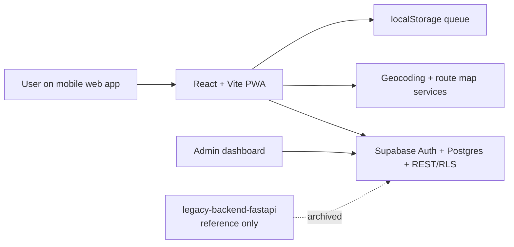

# Aegis

Aegis is a mobile-first women safety PWA for rapid emergency response, trusted-contact alerts, safe-cab booking, and act-now guidance. The production app is now powered directly by Supabase; the legacy FastAPI backend has been preserved under `legacy-backend-fastapi` for reference and migration history.

## Features

- Police, ambulance and safe-cab emergency flows
- Trusted-contact alerting with Google Maps live link sharing
- Voice input with Hindi / English / Marathi support
- Offline queueing and retry for emergency alerts
- Admin dashboard with alert filters, stats and heatmap
- Delete-my-data privacy action and local TEST MODE flag
- PWA installability and offline support

## Tech stack

- Frontend: React 19, Vite, Tailwind CSS, React Router, Leaflet, PWA
- Backend: Supabase Postgres + Row Level Security + Auth + Storage
- Notifications: demo alert records generated in Supabase (TEST MODE)
- Deployment: Vercel / GitHub Pages with Supabase environment variables

## Architecture



## Setup

### Frontend

```bash
npm install
cp .env.example .env
npm run dev
```

### Supabase

1. Create a project in Supabase.
2. Open SQL Editor and run `supabase/schema.sql`.
3. Enable Email authentication in Authentication -> Providers.
4. Add your site URL and redirect URL to the GitHub Pages URL or localhost.
5. Copy `VITE_SUPABASE_URL` and `VITE_SUPABASE_ANON_KEY` into `.env`.

## Environment variables

| Variable | Purpose | Example |
| --- | --- | --- |
| `VITE_SUPABASE_URL` | Supabase project URL | `https://xyz.supabase.co` |
| `VITE_SUPABASE_ANON_KEY` | Public anon key | `eyJ...` |
| `VITE_TEST_MODE` | Keeps demo notifications in TEST MODE | `true` |

## Supabase schema

The app expects the tables and policies defined in `supabase/schema.sql`:

- `profiles`
- `contacts`
- `alerts`
- `notifications`

RLS is enabled on every table and admin access is controlled by the `profiles.is_admin` flag.

## Privacy and safety notes

- The app stores location data only for active emergency use and trusted-contact sharing.
- Users can remove their profile, contacts and alerts using the privacy footer action.
- TEST MODE remains enabled for demos unless a production-safe SMS provider is configured.
- The app does not replace emergency services; it links to helpline numbers such as 112 and 108.

## Limitations

- There is no direct police dispatch integration.
- Voice recognition depends on browser support and permissions.
- Some mapping and emergency service details vary by region and device.

## Deployment

### Frontend on GitHub Pages or Vercel

- Add `VITE_SUPABASE_URL` and `VITE_SUPABASE_ANON_KEY` as environment variables.
- For GitHub Pages, use the Pages URL in Auth redirect settings.

### Supabase configuration

- Enable email OTP login in Authentication.
- Configure redirect URLs for production and local dev.
- Use the SQL schema and RLS policies in `supabase/schema.sql`.

## Legacy backend notice

The earlier FastAPI backend remains in this repository for reference, but Phase 9 migrates the app to Supabase-only data access. A copy is kept at `legacy-backend-fastapi` and is not used by the current app.
