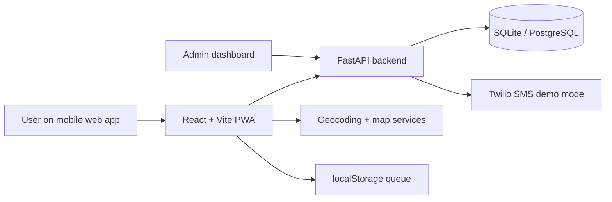

# Aegis

Aegis is a mobile-first women safety PWA for quick emergency response, trusted-contact alerts, safe-cab booking, and act-now guidance. It combines a React frontend with a FastAPI backend and is designed for demo and deployment workflows in mobile-first environments.

## Features

- Police, ambulance and safe-cab emergency flows
- Trusted-contact alerting with live location and maps links
- Voice input with Hindi/English support
- Offline queueing and retry flow for alert submission
- Admin dashboard with alert filters, stats and map heatmap
- Delete-my-data and privacy reminders
- PWA shell for installability and offline use

## Tech stack

- Frontend: React 19, Vite, Tailwind CSS, React Router, Leaflet
- Backend: FastAPI, SQLAlchemy, SQLite default, PostgreSQL-compatible configuration
- Notifications: Twilio SMS demo flow (TEST_MODE safe defaults)
- Deployment: Vercel / Render / Docker / Docker Compose

## Architecture



## Screenshots

Placeholder: add screenshots of Home, Police flow, Ambulance flow, Cab flow, and Admin dashboard when the project is finalized for launch.

## Setup

### Frontend

```bash
npm install
cp .env.example .env
npm run dev
```

### Backend

```bash
cd backend
python -m venv .venv
source .venv/bin/activate  # Windows: .venv\Scripts\activate
pip install -r requirements.txt
cp .env.example .env
uvicorn app.main:app --reload --port 8000
```

## Environment variables

| Variable | Purpose | Example |
| --- | --- | --- |
| `VITE_API_URL` | Frontend backend base URL | `http://localhost:8000` |
| `VITE_TEST_MODE` | Prevents real SMS/alert actions in demos | `true` |
| `DATABASE_URL` | Database connection string | `sqlite:///./aegis.db` or PostgreSQL URL |
| `JWT_SECRET` | JWT signing secret | `change-this-secret` |
| `JWT_ALGORITHM` | JWT signing algorithm | `HS256` |
| `ADMIN_PHONES` | Comma-separated list of admin numbers | `+919000000000` |
| `CORS_ORIGINS` | Allowed frontend origins | `http://localhost:5173` |
| `TWILIO_ACCOUNT_SID` | Twilio account SID | optional |
| `TWILIO_AUTH_TOKEN` | Twilio auth token | optional |
| `TWILIO_FROM_NUMBER` | SMS sender number | optional |

## API overview

- `POST /alerts` - Create an alert for the current user
- `GET /alerts` - List the current user’s alerts
- `GET /admin/alerts` - Admin-only filtered alert list
- `GET /admin/stats` - Admin-only aggregated alert stats
- `PATCH /admin/alerts/{id}` - Update alert status
- `DELETE /me` - Delete current user's data
- `GET /health` - Backend health check

## Privacy and safety notes

- The app stores location data only for active emergency use and trusted-contact sharing.
- Alerts and location info can be removed by the user via the privacy footer action.
- Test mode must stay enabled for demos and local validation unless production-safe SMS and emergency flows are configured intentionally.
- The app does not replace emergency services; it links to helplines such as 112 and 108 and encourages direct calls when needed.

## Limitations

- There is no direct API integration with the official police dispatch system.
- The app relies on helpline numbers (112 / 108) and trusted-contact alerts rather than an external dispatch backend.
- Voice recognition depends on browser support and user permissions.
- Some mappings and emergency services may vary by region and device capability.

## Deployment

### Frontend (Vercel)

- Add `VITE_API_URL` in your Vercel environment.
- Set the build command to `npm run build` and output directory to `dist`.

### Backend (Render)

- Use the included backend Dockerfile or the `uvicorn app.main:app --host 0.0.0.0 --port 8000` start command.
- Set `DATABASE_URL` to a managed PostgreSQL URL such as Neon or Supabase.
- Configure `CORS_ORIGINS` to match the deployed frontend domain.

## Contributing

This project follows the phased plan in `PROJECT.md`. Do not add extra feature work beyond the current phase unless the plan is intentionally updated.
